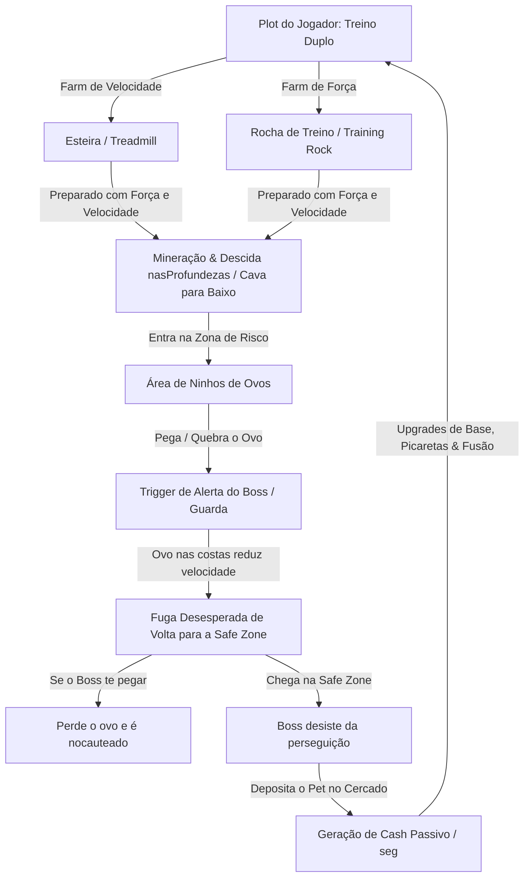

# Especificação do Game Core Loop: Drill and Steal an Eggs

> **Base Arquitetural**: Velvet Framework / ref_PSX (`src/`)  
> **Fontes de Engenharia Reversa**:
> - `ref_StealAnEgg`: Mecânica principal de roubo de ovos, carregamento (`Carrying`), fuga da área de perigo, perseguição pelo Boss/Guarda, esteiras de velocidade (`Treadmill`), cercado de pets (`Plot`) e máquina de fusão.
> - `ref_MinePerClick`: Mecânica de treino de Força na Rocha privada, descida por profundidades, auras e offline earnings.
> - `ref_PSX`: Padrão de Worlds/Spawns (`ReplicatedStorage/__DIRECTORY/Worlds`), spawn de objetos em zonas, Framework Velvet, Directory puro e networking seguro.
> - `ref_BreakAndStealAnEgg`: HP de ovos, dano de picareta e animações de impacto.

---

## 1. Visão Geral do Fluxo Principal (Loop de Fuga & Farm)

---

## 2. Detalhamento de Cada Etapa do Loop

### Etapa 1: Treino Duplo no Plot Privado (Velocidade na Esteira + Força na Rocha)
No seu próprio Plot pessoal (100% seguro de outros jogadores e bosses), o jogador prepara seus atributos:
1. **Atribuição Exclusiva de Plot (`PlotServer.luau` & `PlotClient.local.luau`)**:
   - Cada jogador recebe automaticamente um dos Plots de 1 a 6 ao entrar no servidor.
   - Plots ocupados não podem ser tomados por outros jogadores.
   - A placa do plot (`PlayerPlotSign`) atualiza com a foto do avatar (`rbxthumb`) e nome do jogador.
   - O ícone da casa flutuante (`YourBase`) fica visível e rastreável à distância apenas para o dono do plot.
   - Ao nascer ou renascer, o jogador surge diretamente no `Spawn` do seu respectivo Plot.
2. **Esteira (Treadmill - ref_StealAnEgg)**:
   - O jogador sobe na esteira para farmar **Speed (Velocidade de Corrida)**.
   - Quanto maior a velocidade base, mais rápido o jogador consegue cruzar a área dos ninhos e escapar do Boss com o peso do ovo nas costas.
3. **Rocha de Treino Privada (Training Rock - ref_MinePerClick)**:
   - O jogador bate na sua rocha para farmar **Strength (Força)**.
   - A Força aumenta a velocidade de cavar para baixo e o dano das picaretas/ferramentas contra ovos mais resistentes.
4. **Cálculo Offline**:
   - Ambas as estações de treino contam com progressão offline defensiva (respeitando o teto de 12 horas).

### Etapa 2: Cava para Baixo & Entrada na Área das Profundezas
- O jogador se desloca do Plot e **cava/desce para as profundezas** através das camadas de solo.
- Ao alcançar a profundidade desejada, ele cruza o portal/túnel de entrada e adentra a **Zona de Ninhos (Guard / Boss Area)**.

### Etapa 3: Sistema de Spawn de Ovos e Proximidade do Boss (Padrão ref_PSX Worlds)
Inspirado na arquitetura de spawns do `ref_PSX` (`worlds  Spawn.luau` com tabelas ponderadas de objetos por área):
- **Distribuição Espacial por Risco**:
  - **Próximo à Safe Zone (Entrada)**: Ovos Comuns e Incomuns (pouco risco, fácil de escapar, ovos mais leves).
  - **Meio da Área**: Ovos Raros e Épicos.
  - **Profundo / Covil do Boss (Mais Longe da Saída)**: Ovos Lendários, Míticos e Secretos ficam nos ninhos mais distantes, exatamente ao lado do covil do Boss.
- **Tabela de Spawns (`Directory/Worlds` ou `Directory/Eggs`)**:
  - Cada ninho/área possui lista de ovos com pesos percentuais (`spawnWeight`), HP de quebra e multiplicadores de penalidade de peso ao carregar.

### Etapa 4: Coleta/Quebra do Ovo e Alerta do Boss
- Ao interagir/quebrar o ovo:
  - O jogador passa para o estado **Carrying (Carregando Ovo nas Costas)**.
  - O peso do ovo aplica um redutor percentual sobre a velocidade do jogador (ex: ovos comuns reduzem 10%, ovos míticos reduzem até 40% da velocidade).
  - O **Boss Guardião da Zona** é imediatamente alertado e inicia a perseguição contra o invasor!

### Etapa 5: Fuga Desesperada & Limite da Safe Zone (Perseguição & Desistência)
- O jogador precisa correr de volta para a entrada/safe zone desviando dos ataques do Boss.
- **Mecânica de Desistência do Boss**:
  - A Safe Zone possui um perímetro protegido (`SafeZoneBoundary`).
  - Assim que o jogador cruza a linha de segurança:
    - O Boss perde o alvo, emite animação/áudio de frustração e retorna para patrulhar o seu ninho.
    - O jogador respira aliviado e pode transportar seu ovo com segurança até o seu Plot.
- **Se o Boss alcançar o jogador antes**:
  - O jogador recebe um golpe que dropa o ovo (ou o destrói) e é empurrado/teleportado de volta ao início da zona.

### Etapa 6: Chocagem & Posicionamento no Cercado (Plot Pen)
- No Plot, o ovo é chocado e o Pet é adicionado ao **Cercado**.
- O Pet gera **Cash Passivo por Segundo** com base em:
  $$\text{Cash/seg} = \text{BasePet} \times \text{MultiplicadorPeso} \times \text{MultiplicadorMutação}$$
- O Cash é utilizado para:
  1. Comprar **Picaretas Melhores** (cavar mais rápido para baixo e quebrar ovos mais duros).
  2. Comprar **Upgrades da Esteira e da Rocha** (aumentar ganho de Speed e Strength por treino).
  3. Expandir a capacidade do cercado e usar a **Máquina de Fusão**.

---

## 3. Mapeamento Arquitetural (Velvet Framework em `src/`)

| Funcionalidade | Configuração Estática (`Directory/`) | Autoridade do Servidor (`ServerScriptService/Library/`) | Utilitários & Visual Cliente (`Libray/Client/` & `StarterPlayerScripts/`) |
| :--- | :--- | :--- | :--- |
| **Persistência & Status HUD** | `Directory/Saving/DefaultStats.luau` (`Speed`, `Strength`, `Money`) | `Saving.luau` (ProfileStore, `GetStats`, `StatsUpdated`, Attributes) | `Save.luau`, `StatusHUD.local.luau` (atualiza `Main.Frame.Status.(Frame).Value`) |
| **Treino Duplo (Rocha + Esteira)** | `Directory/Training/TrainingStations.luau` | `TrainingServer.luau` (valida treino de Força e Velocidade, aplica stats) | `TrainingCmds.luau` + feedback visual/animações na esteira e rocha |
| **Spawns de Ovos & Zonas** | `Directory/Worlds/SpawnWorlds.luau`, `Directory/Eggs/` | `AreaEggServer.luau` (ciclo de spawn de ovos nos ninhos por distância/raridade) | `EggCrackingVisuals.luau` (apresentação visual dos ovos e raridades) |
| **IA do Boss & Perseguição** | `Directory/Monsters/Bosses.luau` | `BossChaseServer.luau` (Pathfinding/Chase até o limite da Safe Zone) | `BossVisualsController.luau` (música de perseguição, rugido e VFX) |
| **Mecânica de Carregar Ovo** | `Directory/Eggs/EggWeights.luau` | `CarryServer.luau` (aplica penalidade de velocidade, valida drop/safe zone) | `CarryCmds.luau` (anexa modelo do ovo às costas do personagem) |
| **Cercado & Renda Passiva** | `Directory/Plots/PlotUpgrades.luau` | `PlotServer.luau` (gestão do cercado, acúmulo de cash e coleta) | `PlotCmds.luau` + movimentação dos pets no cercado |
| **Fusão & Lojas** | `Directory/Fuse/`, `Directory/Pickaxes/` | `FuseServer.luau`, `ShopServer.luau` | `FuseMachineGui.local.luau`, `ShopGui.local.luau` |

---

## 4. Regras de Segurança e Anti-Exploit (Mentor Notes)

1. **Anti-Speed Hack / Teleporte com o Ovo**:
   - O servidor controla a velocidade máxima permitida do jogador (`Speed` real + bônus de esteira - penalidade de peso do ovo).
   - Se o cliente tentar teleportar direto do ninho raro para a Safe Zone, o servidor detecta a variação anormal de distância por frame (`DeltaPosition / DeltaTime > MaxPermittedSpeed`) e cancela o roubo.
2. **Autoridade do Perímetro da Safe Zone**:
   - A entrada na Safe Zone é checada estritamente pelo servidor através da posição do `HumanoidRootPart` em relação à bounding box da zona segura.
3. **Persistência dos Atributos Duplos**:
   - O template de dados (`DefaultStats.luau`) armazena separadamente `Strength` e `Speed`, garantindo persistência via ProfileStore sem duplicação ade atributos.